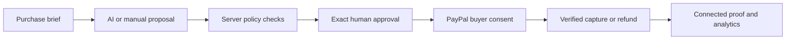

# SpendProof

### AI purchase decisions with PayPal sandbox payment proof

[Live application](https://spendproof.spendproof.workers.dev/) · [Recorded walkthrough](https://spendproof.spendproof.workers.dev/?view=replay) · [Evaluation guide](docs/REVIEW_GUIDE.md) · [Architecture](docs/ARCHITECTURE.md)

SpendProof connects a purchasing brief to an offer, its source evidence, a policy decision, explicit approval, and the resulting payment record. AI assists with selection and analysis; the server calculates amounts, enforces policy, and controls payment operations.

The application is deployed on Cloudflare Workers with D1. The current interface and report-assistant update were verified on the public application on **9 November 2026**. All payment integrations use **PayPal sandbox** and simulated funds.

## The decision behind the purchase

A request for three design licences has a $60 limit and permits one-time purchases. A $36 offer initially appears cheaper, but renews monthly. SpendProof blocks that proposal, evaluates a $54 one-time alternative, and retains the evidence behind both decisions.

An allowed proposal is eligible for review. It becomes payment authority only after explicit approval of that exact proposal and policy version. Buyer approval in PayPal is a separate step; a verified capture establishes payment completion.



## Core capabilities

| Area              | Implementation                                                                                                                    |
| ----------------- | --------------------------------------------------------------------------------------------------------------------------------- |
| Purchasing        | Natural-language briefs, optional AI constraint drafting, controlled offer comparison, and source-backed proposals.               |
| Decision controls | Nine checks covering quantity, currency, merchant, quoted terms, evidence, billing, spending caps, and available allowance.       |
| Approval          | Versioned proposals, policy snapshots, approval fingerprints, expiry, and explicit renewal of unchanged approvals.                |
| Payment lifecycle | Durable reservations, PayPal order creation, verified capture, reconciliation, full refunds, and idempotent operation keys.       |
| Evidence          | Proposal history, purchase-scoped signed webhook receipts, redacted JSON exports, and a printable proof view.                     |
| Analysis          | Native AG Studio widgets, six data sources, AI-assisted reports, linked charts and tables, purchase drilldown, and saved layouts. |
| Evaluation        | A recorded provider walkthrough, policy fixtures, recovery simulations, recurring-cost projections, and policy previews.          |

## Integrations

- **PayPal:** sandbox Orders and Payments APIs, hosted buyer approval, canonical capture/refund verification, and webhook signature verification.
- **AG Studio:** native report editing, custom widgets, cross-filtering, and an AI harness whose tools inspect data or edit report layout.
- **Groq:** structured purchase proposals and report assistance through a server-side adapter with bounded recovery for invalid tool arguments.
- **Cloudflare:** a Worker serves the API and built frontend; D1 stores workspace state, approval records, financial accounting, and evidence.

The frontend uses React and TypeScript. Hono handles API routing; Zod validates structured inputs. Vite builds the frontend with Rollup's official WebAssembly distribution.

## Evaluate the application

Start with the [recorded walkthrough](https://spendproof.spendproof.workers.dev/?view=replay) to inspect an earlier $54 sandbox capture, full refund, and signed notification deliveries. Playback makes no provider calls and does not alter the current workspace.

For interactive evaluation, create a three-licence request with a $60 cap, compare the monthly offer with the $54 one-time offer, inspect the decision evidence, and open **Overview → Explore in Studio**. The [evaluation guide](docs/REVIEW_GUIDE.md) covers the full journey and an optional sandbox buyer test.

## Local development

Requires **Node.js 22.13 or newer** and npm. Windows users should follow the [Windows 11 guide](START-HERE-WINDOWS.md), which uses `npm.cmd` and `npx.cmd`.

```sh
git clone https://github.com/KratishaTandon1/spendproof.git
cd spendproof
npm ci
npm test
npm run build
npm start
```

Open [the local application](http://127.0.0.1:5173/). The launcher applies local migrations and starts the API on port 8787 and frontend on port 5173. Stop both with Ctrl+C.

Manual catalogue evaluation and recorded playback work without service credentials. AI assistance, licensed Studio operation, and new sandbox payments require the settings described in [Configuration](docs/CONFIGURATION.md). Python 3 is optional for private setup and the setup/packaging test suite.

## Verification

The current code passed **52 application tests**, **16 Python setup and packaging tests**, TypeScript checks, a production build, and a Cloudflare deployment dry run. Provider-backed testing separately verified sandbox payment cycles and live AI/report behavior. See the [verification record](docs/TEST_EVIDENCE.md) for dates, methods, and coverage limits.

## Scope

This is a sandbox commerce prototype with four fictional offers, one controlled merchant, USD prices, one-time captures, and full refunds. The $150 initial allowance is application accounting, not a PayPal wallet balance. The catalogue does not provide real goods or fulfilment.

Unresolved provider outcomes retain their accounting state until reconciled or investigated. The application does not claim universal exactly-once processing, independent audit certification, or production payment readiness.

## Documentation

| Document                                                 | Purpose                                                              |
| -------------------------------------------------------- | -------------------------------------------------------------------- |
| [Architecture](docs/ARCHITECTURE.md)                     | Authority boundaries, data flow, persistence, and recovery behavior. |
| [Configuration](docs/CONFIGURATION.md)                   | Service settings, private setup, and feature availability.           |
| [Deployment](docs/DEPLOYMENT.md)                         | Existing-demo maintenance and independent deployment.                |
| [Windows 11 guide](START-HERE-WINDOWS.md)                | Installation, local operation, and maintenance on Windows.           |
| [Evaluation guide](docs/REVIEW_GUIDE.md)                 | Reviewer walkthrough and demo sequence.                              |
| [Verification record](docs/TEST_EVIDENCE.md)             | Automated coverage and observed provider behavior.                   |
| [Report-assistant reliability](docs/AI-ASSISTANT-FIX.md) | Tool-argument validation and bounded retry design.                   |

## Licence

The application source is [MIT licensed](LICENSE). Third-party dependencies retain their respective licences. AG Studio Pro with AI requires appropriate product coverage; a trial does not confer a permanent production licence.
